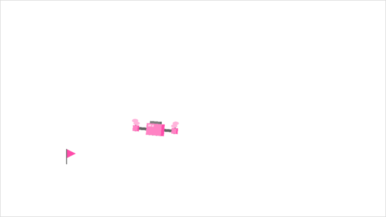

# Planar Quadrotor LQR

[](https://github.com/praha6248/planar-quadrotor-lqr/actions/workflows/ci.yml)

🇵🇱 [Wersja polska](README.pl.md)

A 2D (planar) quadrotor simulation controlled by a discrete **LQR** regulator.
Clicking in the window sets a new target (a flag), and the controller flies the drone there while
stabilising its position and attitude. After the flight you can plot the trajectory.

<p align="center">
  
</p>


## Features

- **Planar quadrotor dynamics**: state `[x, y, θ, ẋ, ẏ, θ̇]`, two inputs (rotor thrusts).
- **LQR controller**: the model is linearised around hover, discretised (`A_d = I + dt·A`, `B_d = dt·B`),
  and the gain matrix `K` is obtained by iterating the discrete Riccati equation for the chosen
  weights `Q` and `R`. Control law: `u = u_hover − K·(x − x_goal)`.
- **SDL2 / SDL2_gfx visualisation**: body with spinning propellers and a flag at the target.
- **Interaction**: left mouse button sets a new target, `P` plots the flight trajectory (Matplot++).
- **Engine sound** played through SDL Audio (`PlanarQuadrotor/*.wav`).

## Building

Dependencies (SDL2, SDL2_gfx, Matplot++) are git submodules; Eigen is fetched by CPM at configure time.

```bash
git clone --recursive https://github.com/praha6248/planar-quadrotor-lqr.git
cd planar-quadrotor-lqr
cmake -S . -B build
cmake --build build -j
```

With newer GCC versions the bundled Matplot++ does not compile without the `<cstdint>` header.
In that case configure with:

```bash
cmake -S . -B build -DCMAKE_CXX_FLAGS="-include cstdint"
```

Run from the repository root so the program finds the sound files:

```bash
./build/planar_quadrotor
```

On Windows, open the folder in Visual Studio or VS Code with CMake Tools.

## Tests

The model and the controller are built as a separate library (`quadrotor_core`), so they can be
tested without SDL or the submodules:

```bash
cmake -S . -B build -DPQ_BUILD_APP=OFF -DPQ_BUILD_TESTS=ON
cmake --build build
ctest --test-dir build --output-on-failure
```

The GoogleTest suite checks:

- **dynamics**: hover thrust cancels gravity, free fall, torque from differential thrust,
  sideways acceleration when tilted;
- **linearisation**: `A` and `B` match a central-difference Jacobian of the nonlinear model;
- **LQR**: a scalar system reproduces the analytic Riccati solution, and the closed loop
  `A_d − B_d·K` has spectral radius < 1;
- **end-to-end**: the nonlinear simulation with the LQR law reaches a target 2 m away within 15 s.

GitHub Actions runs the tests and a full simulator build on every push.

## Project layout

```
PlanarQuadrotor/
  planar_quadrotor.{h,cpp}             dynamics model, linearisation, gravity compensation
  lqr.{h,cpp}                          discrete LQR gain computation
  planar_quadrotor_visualizer.{h,cpp}  drawing the drone with SDL
  simulate.{h,cpp}                     simulation loop, mouse/keyboard, sound, plot
  normal.wav, slow.wav                 engine sounds
tests/test_quadrotor.cpp               unit tests (GoogleTest)
cmake/CPM.cmake                        dependency manager (Eigen)
matplotplusplus/, SDL/, SDL2_gfx/      submodules
```

## Origin

Built for the Programming Techniques course on top of the
[marekjg/tp_projekt_4](https://github.com/marekjg/tp_projekt_4) template (CMake setup and class skeleton).
My part: completing the model and the controller, tuning the Q and R matrices, propeller and target-flag
visualisation, mouse target selection, trajectory plot and sound.

## Tech

C++17 · Eigen · SDL2 · SDL2_gfx · Matplot++ · CMake · CPM · GoogleTest · GitHub Actions
